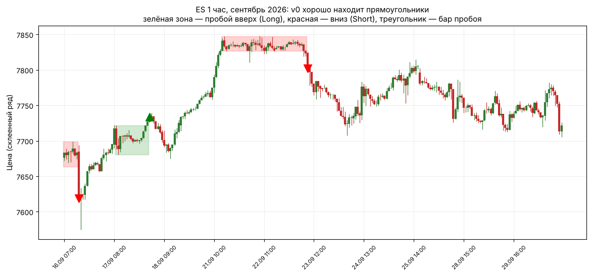
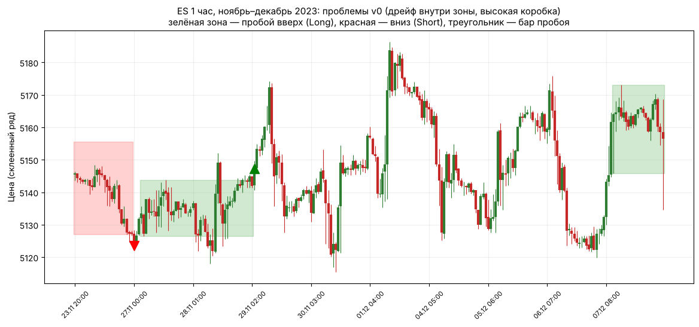

# Детектор консолидации v0

**v0** — первая версия: только явные правила, без машинного обучения. Её задача — дать понятный бэйзлайн, с которым потом сравниваются все улучшения и ML-подходы.

Почему не взяли готовое: мы разобрали открытый проект [CDF](https://github.com/tg12/cdf). В нём нет явного определения консолидации (веса подбираются под прибыль от пробоев, получается порочный круг), зоны фиксированной длины и перекрываются, а код не тянет наши объёмы данных. Оттуда взяли только идеи: мерить всё относительно типичного размаха свечи и проверять результат на отложенных периодах.

## Три вопроса к окну из последних n свечей

Детектор идёт по графику и на каждой свече смотрит на последние **n = 12** свечей. Окно должно ответить «да» на все три вопроса.

### 1. Коридор узкий? — `box_score`

Проводим линии по самому высокому High и самому низкому Low окна. Ширину коридора сравниваем с шириной, которую дало бы **случайное блуждание** из обычных свечей.

Случайно бродящая цена расширяет коридор не пропорционально числу свечей n, а примерно как √n (пьяный пешеход за 100 шагов уходит от фонаря шагов на 10). Поэтому:

```
box_score = ширина коридора / (размер обычной свечи × √n)
```

Меньше 1 — коридор уже, чем у случайного блуждания: цену что-то держит.

### 2. Цена никуда не идёт? — `er_score`

**ER (коэффициент эффективности Кауфмана)** — какая доля пройденного пути ушла в реальное смещение:

```
ER = |Close сейчас − Close n свечей назад| / сумма |изменений Close| за n свечей
```

| Пример (5 шагов) | Смещение | Путь | ER |
|---|---|---|---|
| 100 → 105 ровно вверх | 5 | 5 | 1.0 — тренд |
| 100, 102, 100, 102, 100, 102 | 2 | 10 | 0.2 — пила |

У случайного блуждания ER в среднем около 1/√n, поэтому фиксированный порог вроде «ER < 0.3» не работает: при n = 50 его проходит 91% случайных блужданий. Поэтому используем `er_score = ER × √n`: около 1 — как случайное блуждание, меньше 1 — топчется, больше 1 — тренд.

### 3. Свечи мельче обычного? — `comp_score`

Средний размах свечей окна, делённый на размер обычной свечи. 0.7 значит, что свечи на 30% мельче обычного: рынок «сжался».

### Что такое «обычная свеча»

ES торгуется почти круглосуточно, и ночные свечи всегда мелкие. Если сравнивать со средним по всем часам, детектор будет находить «консолидацию» каждую ночь.
Поэтому каждая свеча сравнивается с **обычной свечой того же часа**: медианой размаха за последние 20 свечей этого часа по времени Нью-Йорка. Используется только прошлое, будущее не подглядывается.

## Как растёт зона

1. На свече t все три условия выполнены (`box < 1.0`, `ER·√n < 1.0`, `сжатие < 0.9`) → **зона началась**. Коробка = High и Low окна.
2. Каждая следующая свеча, закрывшаяся внутри коробки (тени за границу можно), **продлевает зону**.
3. Первое закрытие за границей дальше 0.5 обычной свечи → **пробой**: вверх = Long, вниз = Short.
4. Новую зону ищем только после бара пробоя.

Всё в логарифмах цены, поэтому склейка фьючерсов и разный масштаб цен ни на что не влияют.

## Первые результаты: ES, 1 час, ноябрь 2021 — сентябрь 2026

28 802 свечи, расчёт занимает 1.5 секунды.

| Показатель | Значение |
|---|---|
| Зон | 454, около 7.6 в месяц |
| Доля времени внутри зон | 37.6% |
| Длительность зоны | медиана 20 свечей, у 80% зон от 14 до 40 |
| Ширина коробки | медиана 2.6 обычных свечи |
| Пробоев вверх / вниз | 53.5% / 46.5% |

**Проверка, что детектор находит что-то настоящее.** После тихих периодов волатильность почти всегда растёт: это просто возврат к среднему. Поэтому сравниваем с честной случайной базой — случайными окнами той же длины и с такой же тихой волатильностью внутри:

| | Рост волатильности за 12 свечей после окна |
|---|---|
| После зон детектора | × 1.16 |
| После похожих случайных окон | × 1.045 |

Эффект «сжатие → расширение» есть сверх простого возврата к среднему.

**Направление пробоя само по себе ничего не говорит.** Через 12 свечей после пробоя цена идёт дальше в его сторону только в 47% случаев — монетка. Именно поэтому нужна часть 2: модель должна найти, *какие* пробои продолжаются.



## Найденные проблемы → v0.1



1. **Наклонные коридоры проходят как зоны.** Слева на картинке цена медленно сползает вниз внутри «зоны». Решение: регрессия по High и по Low окна; обе прямые должны быть почти горизонтальными. Наклонные каналы и треугольники отсекаем — консолидация у нас только прямоугольник.
2. **Слишком высокая коробка**, если в окно попала импульсная свеча (справа). Решение: строить коробку по закрытиям или отсекать крайние тени.
3. **Зона не перепроверяется**, пока растёт. Решение: проверять ширину и наклоны на всей зоне, а не только на окне старта.
4. **37.6% времени в зонах — многовато.** Пороги пока выбраны на глаз, их нужно подбирать (см. [идеи](03_идеи_и_задачи.md)).

## Файлы прототипа

- `detector_v0/box_v0.py` — метрики (`compute_metrics`) и поиск зон (`detect_zones`), параметры в `BoxV0Params`.
- `detector_v0/run_box_v0.py` — запуск на инструменте, статистика, проверка на случайных окнах, интерактивный график.

Таблица зон (`*_zones_v0.parquet`), по строке на зону: `start_time`, `formed_time` (когда детектор понял, что это зона), `end_time`, `breakout_time`, `direction` (+1 / −1 / 0, если зона не закрылась), `box_hi`, `box_lo`, `duration`, `width_pct`, `width_in_bars` и метрики на момент старта.
